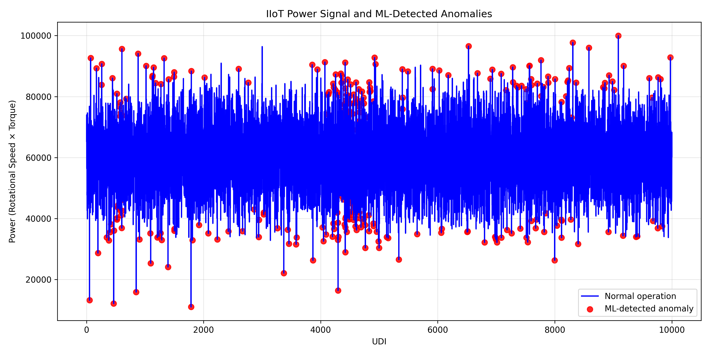

# IIoT Predictive Quality & Anomaly Detection Pipeline

This project builds an end-to-end Industry 4.0 analytics workflow that ingests machine telemetry, engineers operational features, and detects anomalies using both statistical thresholding and machine learning. It is designed as a practical digitalization proof-of-concept for predictive quality and predictive maintenance scenarios in smart manufacturing environments.

The pipeline reads the AI4I 2020 Predictive Maintenance Dataset, loads it into SQLite, derives physical operating indicators like temperature difference and power, applies z-score anomaly detection, trains an Isolation Forest model, and visualizes the most important deviations in operational behavior.

## Technology Stack

- Python 3
- Pandas
- SQLAlchemy
- SQLite
- scikit-learn
- SciPy
- Matplotlib

## Repository Structure

```text
iiot-anomaly-pipeline/
├── data/
│   ├── raw/
│   └── processed/
├── src/
│   ├── __init__.py
│   ├── 1_ingest_data.py
│   ├── 2_feature_engineering.py
│   ├── 3_anomaly_detection.py
│   └── 4_visualize.py
├── output/
├── .gitignore
├── requirements.txt
└── README.md
```

## Installation

1. Clone the repository.
2. Create and activate a virtual environment:

```bash
python -m venv .venv
source .venv/bin/activate
```

3. Install the required dependencies:

```bash
pip install -r requirements.txt
```

4. Download the AI4I 2020 Predictive Maintenance Dataset from the UCI Machine Learning Repository and save it as:

```text
data/raw/ai4i2020.csv
```

## Run the Pipeline

Run each stage in order:

```bash
python src/1_ingest_data.py
python src/2_feature_engineering.py
python src/3_anomaly_detection.py
python src/4_visualize.py
```

The scripts will create the SQLite database (`factory_telemetry.db`) and generate a saved anomaly plot in `output/anomaly_plot.png`.

## Results



## Use Cases

This project is well-suited for manufacturing analytics, equipment health monitoring, predictive maintenance, and industrial digitalization use cases where real-time anomaly detection can reduce downtime and improve process stability.
